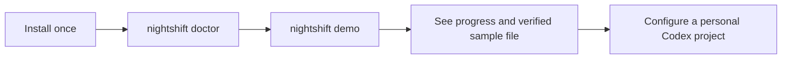

# Install Nightshift and run your first workflow

The first demo runs entirely locally. You need the installed .NET 10 runtime, Git and the usual macOS shell tools. Building/installing from this checkout uses SDK 10.0.103; running the installed command does not use the source folder or its `global.json`.



## 1. Install for your user

```sh
bash /Users/adamkimberley/Repos/nightshift/scripts/install.sh install
```

Expected final version: `nightshift 0.2.1`. The helper builds a local package and uses the standard .NET user tool directory. It checks for a conflicting command, changes only the Nightshift tool, and does not run models or modify shell configuration.

If it reports a PATH issue:

```sh
export PATH="$HOME/.dotnet/tools:$PATH"
nightshift --version
```

That PATH change applies to this Terminal tab. To make it permanent, add that same export line to your own shell startup configuration when you choose. The installer does not edit it. You can also run `~/.dotnet/tools/nightshift --version` directly. An installation success does not establish that a new Terminal's PATH has been configured.

If .NET itself cannot start, inspect `dotnet --list-runtimes`. This build targets `Microsoft.NETCore.App 10.0`; obtain the required runtime yourself if absent. SDK upgrades/installers are not part of Nightshift's helper. For a missing SDK during local package build, inspect `dotnet --list-sdks` and the checkout's `global.json` before changing anything.

## 2. Diagnose setup

```sh
nightshift doctor
```

Doctor reports its installation/version, project config, workspace/output root, selected backend/sandbox, Codex path/version/interface and stored authentication status. Its version/help/login-status probes are bounded and read-only. It neither logs in nor starts a model, and it does not print raw authentication output.

An unconfigured project defaults to the scripted backend. Codex/auth problems are warnings in that mode; they block a configured real-Codex project. Follow each reported next action. A stored login is not proof of live model access. Use `nightshift doctor --json` for structured diagnostics.

## 3. Run the offline demo

From any personal working directory:

```sh
nightshift demo
```

No shell variables, workflow file, credentials or account are required. The command creates a unique scratch workspace internally, simulates a planning worker, uses a local command to write `demo-output.txt`, and uses a second command to compare its exact bytes. The expected content is one line, `NIGHTSHIFT_DEMO_OK`, followed by a newline.

Expected progress includes:

```text
Offline demo: simulated model planning, local file creation and independent byte comparison; no account or model.
Stage plan: running | visit 1, attempt 1
Stage create: running | visit 1, attempt 1
Stage verify: running | visit 1, attempt 1
success: Pipeline reached exit; visited goal gates satisfied
Tool verdict: verify: success (tool goal gate)
Declared output (exists; existence alone is not verification): .../demo-output.txt
```

Paths and elapsed times vary. During a quiet worker, a progress line appears every five seconds. The terminal does not invent percent completion or a total number of visits for cyclic graphs. A `goal_gate_has_retry` warning on a demo verifier is expected: it deliberately stops on failure instead of scheduling a repair.

```sh
nightshift status --latest
nightshift result --latest
```

Both commands select this project's latest run. `result` shows the worker response, tool verdicts, declared output paths, checkpoint and logs. Simulation is explicitly labeled. The demo proves the installed local path through the engine, not model quality.

## 4. Try real Codex when ready

These commands can consume usage. The read-only demo creates its own input and independently checks that the model reported the unique unchanged file contents:

```sh
nightshift demo --backend codex --enable-codex
```

For one tiny file-writing task followed by a byte-level local verifier:

```sh
nightshift demo --backend codex --enable-codex --write --sandbox workspace-write
```

Each has one model stage, zero automatic retries, a 120-second stage timeout and a 180-second overall default limit. Timeout is not a token/spend cap. The default `nightshift demo` stays offline even when the surrounding project has saved real-worker defaults. Installed real modes were tested with fake processes during development; they were not automatically exercised against a real model.

For daily use, continue to [configure a Codex project](codex-project.md), rather than adapting a long demo command.

## Update or uninstall

```sh
bash /Users/adamkimberley/Repos/nightshift/scripts/install.sh update
```

To remove only the installed command/package:

```sh
bash /Users/adamkimberley/Repos/nightshift/scripts/install.sh uninstall
```

Project configuration and evidence are retained. The equivalent direct removal is `dotnet tool uninstall --global Nightshift.Cli`. No public package publication is required: the helper uses the package it built locally. The .NET tool installation mechanism is documented by [Microsoft](https://learn.microsoft.com/en-us/dotnet/core/tools/dotnet-tool-install).
