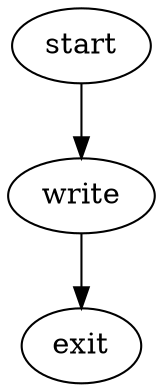

# Protected local workflows (0.3)

The installed CLI defaults to `linux-container-v1`. Start the already configured
runtime yourself when needed; Nightshift never starts or installs it:

```sh
podman machine start nightshift-dev
nightshift doctor
nightshift demo
```

The demo is offline. It uses real network-disabled containers, a deterministic
planning stage, a permitted file edit and a separate exact-byte verifier. Results
are in the external state store printed by the command. The source checkout and
host home are never mounted. See [runtime setup](../container-runtime.md).

For a small personal fixture project, change into its directory:

```sh
nightshift init
```

Edit `nightshift-policy.json`. For example, use this `workflow` value:



And these `checks`:

```json
[{"id":"exact-bytes","command":"printf verified | cmp -s - candidate.txt"}]
```

Review the remaining policy fields, then explicitly adopt them:

```sh
nightshift adopt --policy nightshift-policy.json
nightshift run
nightshift status --latest
nightshift result --latest --json
```

`run` uses the adopted snapshot, so editing the policy file, a project config or DOT
file cannot silently alter an active run. Adopt again to create a new policy for
future runs. A checkpointed run retains its old policy. For interruption/recovery:

```sh
nightshift run --pause-after 1
nightshift resume --latest
```

The state root defaults to `~/Library/Application Support/Nightshift/state` on this
Mac, or `~/.local/state/nightshift` on Linux. An operator may select a fresh separate
root with `--state-root /absolute/path` on each command. Project/worker files cannot
set it. An existing unrelated nonempty directory is refused. Run identity is stable
under `projects/<project-path-hash>/runs/<run-id>`; policy snapshots are siblings.
Protected results distinguish pipeline outcomes, immutable candidate, provenance,
approved policy and the separate code-acceptance decision. Exit 0 requires a
successful pipeline and passing configured checks; pause returns 3.

Offline hosted adapter demonstrations use fake HTTP services and real containers:

```sh
nightshift reference --repository-service github --pipeline-service github-actions
nightshift reference --repository-service azure-devops --pipeline-service azure-pipelines
```

Each creates its own preserved fixture project/run, captures a candidate, makes a
local private Git commit, simulates lost dispatch response, resumes without another
PR/check, and rejects stale evidence after a later change. All four independent
repository/pipeline combinations also have contract tests. No account, model,
network connection, push or hosted operation is performed.

The initial image contains shell fixtures only. Real `codex`/`claude-code` adapters
are implemented, but a live image/auth/network profile remains a separate experiment.
Their presence or stored auth is never reported as live compatibility. `doctor`
separates configuration, runtime prerequisites, fixture evidence, actual isolation
verification and unexecuted live integration. It never infers security from a
successfully installed runtime alone.

Old runs remain readable without changing their evidence:

```sh
nightshift result /absolute/path/to/old/run
```

Legacy execution requires explicit `--profile native-development`. It lacks protected
execution and cannot satisfy the protected acceptance gate. Old phase-two guides
show that historical mode. To transition, keep old folders, review/adopt a new policy
and start a fresh protected run. Protected resume cannot adopt an old writable JSON
checkpoint. Binaries/runtime/profile/backend changes require a fresh run as well.
