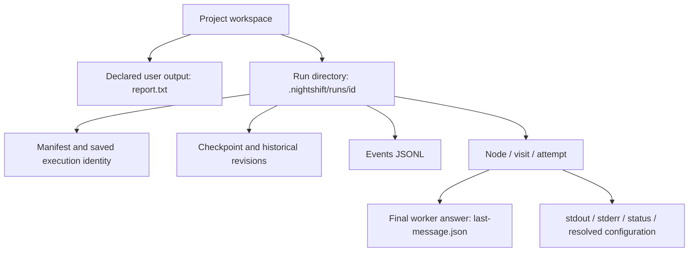
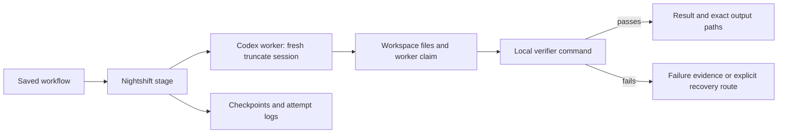

> Historical phase-two native-development guide. In 0.3, executing these examples requires explicit `--profile native-development` and lacks protected acceptance. For current defaults see [protected workflows](protected-workflows.md).

# Find results, understand failures and resume

## What the terminal tells you

Before a run, Nightshift prints project, workflow, workspace, backend, real-worker mode, sandbox and run directory. Each stage prints its visit and attempt. Retries are reported separately from graph revisits. Quiet active stages get a progress message every five seconds; this is elapsed time, not a fabricated completion percentage.

At the end, read the overall outcome and tool verdicts, then follow the printed paths:

```sh
nightshift status --latest
nightshift result --latest
```

`status` summarizes state/next stage and paths. `result` also shows a bounded final-worker-response preview. A model response is a worker claim; a tool stage's success is that command's verdict; a declared file's existence is only existence. These are deliberately labeled separately.

For scripts:

```sh
nightshift status --latest --json
nightshift result --latest --json
```

These emit one JSON document containing state and file locations. Human progress goes to stderr when a run uses `--json`; stdout stays parseable. Plain redirected output uses no terminal animation/ANSI escapes. Raw data remains available through `nightshift inspect` and `nightshift events` with an explicit run path.

## Directory map

The default layout inside a configured project is:

```text
nightshift.json                  Project defaults and explicit real-worker opt-in
workflow.dot                     Your task/check/routing graph
report.txt                       Example declared workspace output
.nightshift/runs/
  .workspaces/<id>/              Isolated workspaces created by demo only
    workflow.dot
    demo-output.txt              Offline demo's output
  <timestamp>-<id>/              One real or simulated engine run
    manifest.json               Original settings, graph hash, workspace, backend
    execution.json              Latest resume settings, when a run has resumed
    execution-history/          Audited resume settings/overrides
    graph.dot                   Exact run graph snapshot
    checkpoint.json             Latest durable continuation/final result
    checkpoints/                Prior checkpoint revisions
    events.jsonl                Structured audit
    <node>/visit-0001/attempt-0001/
      prompt.md                 Stage prompt (adapter adds goal/run instructions)
      last-message.json         Codex's final structured answer
      response.md               Raw Codex JSONL preview or scripted response
      stdout.txt                Full process stdout
      stderr.txt                Full process stderr
      status.json               Handler outcome using external "outcome"
      effective-outcome.json    Exhaustion conversion, when applicable
      configuration.json        Resolved model/fidelity/backend capabilities
```



Not every file exists for every handler. A skipped/interrupted worker may not have a final answer. Outputs you ask Codex to create live in the configured workspace, while responses/logs live in the run directory. Declare known output paths in `outputs` or repeat `--output PATH` for a new run; Nightshift does not guess them from model prose. Config output declarations resolve from the config's directory, even if you choose a different worker directory.

## Execution model



## Resume

```sh
nightshift resume --latest
```

`--latest` is scoped to the selected project and configured run-output root. For status/result it chooses the most recently started run. For resume it chooses the latest interrupted/abandoned resumable run, skips active leases and final outcomes, and explains when none exists. If you move/change the configured output root, use an explicit path to reach an older run.

Resume restores the recorded backend, real-worker opt-in, workspace, sandbox and limits. Changes to current project defaults do not redirect that run. **It never silently changes real Codex to simulation.** Backend, sandbox and workspace changes are rejected; start a fresh run for those changes.

You may explicitly replace an executable path for the same backend if the old installation moved. The replacement is validated and recorded in `execution-history/` plus `execution.json`, without replacing the original manifest or attempt files. A subsequent resume keeps that replacement. Legacy phase-one/core-only runs missing backend identity require explicit backend selection and real-worker permission; Nightshift does not guess. Explicit saved-run paths can be used even when the current project's config is malformed.

Final success/failure/incomplete checkpoints return their saved result rather than replaying the whole workflow. Engine resume does not resume a Codex conversation. An interrupted external effect may repeat, and a repeated model call may consume additional usage.

## Diagnose a failed run

1. Read the failure summary and the latest stage's `status.json`.
2. For process/model errors, inspect the printed stage-log directory's `stderr.txt` and `stdout.txt`.
3. For malformed/incomplete responses, compare `last-message.json`, the generated schema and completion events. Missing status/completion is failure, not implied success.
4. For verifier failure, inspect the file and the verifier command. Do not substitute the worker's success claim for the verifier result.
5. Fix the cause before another attempt. A final failed/incomplete run needs a fresh run; an interrupted run can resume.

| Symptom | Next action |
|---|---|
| `nightshift` not found | Check `~/.dotnet/tools/nightshift --version` and the install guide's one-time PATH setup. |
| Codex not found/invalid path | Run doctor; use an executable file path, not an alias, directory or empty value. |
| Stored login missing | Complete normal CLI login yourself. Doctor does not log in. |
| Missing required CLI flags | Compare the selected CLI's `exec --help`; correct compatibility before spending usage. |
| Unsupported fidelity | Use truncate at graph/node/edge resolution; compact/full/summary remain unsupported. |
| Human gate in redirected mode | Supply `--answers` explicitly; no auto-approval occurs. |
| Visit/time bound reached | Run is final incomplete, not success. Reassess the graph/limits before a fresh run. |
| No resumable latest run | Use status/result to inspect the latest final result, or supply another interrupted run path. |

Exit codes: 0 success; 1 failed/incomplete; 2 input/configuration error; 3 pause/interrupted; 130 cancellation before a resumable run was initialized. Ctrl-C saves state when possible and cleans up attached children. Detached/reparented daemons and power-loss directory durability remain limitations. Run-time limits count checkpointed active time, not downtime or uncheckpointed time lost in a hard crash.
