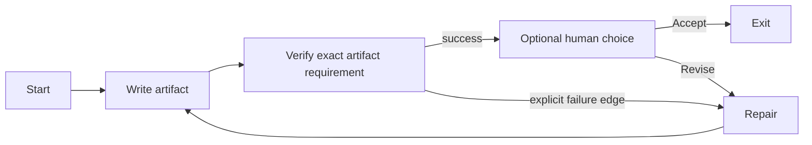

> Historical phase-two native-development guide. In 0.3, executing these examples requires explicit `--profile native-development` and lacks protected acceptance. For current defaults see [protected workflows](protected-workflows.md).

# Write a small workflow

A workflow is a directed DOT graph. Keep task prompts explicit and route using facts or actual check outcomes. Real Codex stages require truncate fidelity; the simulator does not perform the requested coding work.

## Task and independent check

The [Codex project guide](codex-project.md) contains a complete writing/checking example. Its essential shape is:



Here is a bounded-by-run-limits repair/review graph you can adapt in a personal project. Its goal is deliberately tiny so the independent check is understandable:

```dot
digraph RepairAndReview {
  graph [goal="Produce a verified tiny report", default_fidelity=truncate]
  start [shape=Mdiamond]
  write [prompt="Create report.txt containing exactly Hello from Nightshift followed by one newline. Change no other workspace files.", timeout=120s, max_retries=0]
  verify [type=tool, tool_command="printf 'Hello from Nightshift\\n' | cmp -s - report.txt", timeout=5s, goal_gate=true, retry_target=repair]
  repair [prompt="Inspect report.txt and fix it so it contains exactly Hello from Nightshift followed by one newline. Change no other workspace files.", timeout=120s, max_retries=0]
  review [shape=hexagon, label="Accept this verified report?", human.timeout=60s]
  exit [shape=Msquare]
  start -> write -> verify
  verify -> review [condition="outcome=success"]
  verify -> repair [condition="outcome=fail"]
  repair -> verify
  review -> exit [label="[A] Accept"]
  review -> repair [label="[R] Revise"]
}
```

Configure workspace-write deliberately and declare `report.txt` in project `outputs`. After saving the graph as `workflow.dot`:

```sh
nightshift validate
nightshift run --max-visits 12 --max-seconds 300 --answers A
```

This is a real model run when your project is configured for Codex. The finite limits prevent an endless repair cycle; reaching a limit is incomplete, not success. `max_retries=0` bounds *handler retries*, while explicit graph revisits can still invoke a worker again. A repair prompt or preferred model answer is not evidence that the report passed: the independent `cmp` stage supplies the actual command verdict.

Queued `A` is an explicit answer for this test. For unattended revise/accept testing, `--answers R,A` supplies two choices. With interactive input, omit `--answers` to answer in the terminal. In redirected/JSON mode, provide answers explicitly. Exhausted queues skip/fail; invalid or ambiguous choices fail; identities are recorded but unverified. This is not an authenticated approval system.

## Business facts and diamonds

A conditional/diamond stage returns its **own** SUCCESS. Do not use its `outcome=success` to pretend it is the result of the preceding validator. Route directly from the validator as above, or persist a named fact.

A tool or backend can supply this status after actually establishing the fact:

```json
{
  "outcome": "success",
  "context_updates": {"tests_passed": true},
  "notes": "The named test command completed successfully"
}
```

Tool commands can write `status.json` under the supplied `ATTRACTOR_STAGE_DIR`. A nonzero process exit still overrides a success claim. The tool's original status is retained separately. The current Codex final-response schema only requests outcome/notes; do not assume it can emit arbitrary context updates through that adapter.

A downstream edge may then use `condition="context.tests_passed=true"`. Only `=`, `!=` and `&&` are supported; comparisons are exact/case-sensitive, and missing values resolve to empty strings. The [branching example](../../examples/branching.dot) demonstrates the fact/diamond pattern with the scripted simulator; its `script.set.*` attributes are simulator fixtures, not live LLM facts.

## Other useful settings

- `prompt` supports `$goal`; node `timeout` bounds each attempt.
- `max_retries` means additional attempts for RETRY/classified transient failures. FAIL is terminal to that attempt sequence; explicit fail edges/recovery targets handle graph-level recovery.
- `goal_gate=true` checks the latest outcome of visited gates at exit. PARTIAL_SUCCESS satisfies it; a later file mutation can invalidate earlier acceptance, so place important checks after edits.
- Model stylesheets resolve model/provider/reasoning defaults. Explicit node values win. Avoid configuring unsupported fidelity modes just to request more context; this adapter only implements fresh truncate sessions.
- Shell tool commands run with host permissions, independent of the Codex worker sandbox. Review them before running a workflow.

For full semantics and deliberate divergences, read [spec decisions](../spec-decisions.md) and [conformance](../conformance.md). Parallel/fan-in, supervisor loops, persistent conversations and per-tool hooks remain deferred.
