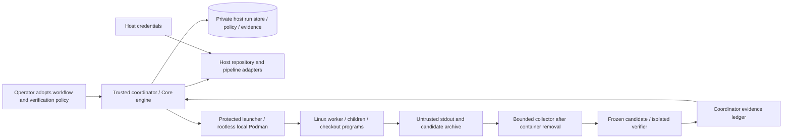

# Phase three architecture

Existing Attractor traversal stays in Nightshift.Core. New immutable agent,
repository, pipeline, execution and evidence contracts contain no provider DTOs.
Nightshift.Adapters supplies process protocols, local Git and HTTP translations,
Podman enforcement, workspace collection and protected orchestration composition.
The CLI composes independent selections and stores approved snapshots externally.

Only disposable worker data is in the dedicated VM share. Per-execution mount:
/workspace; private /tmp is tmpfs, image root read-only, no network, dropped
capabilities, no-new-privileges, separate PID namespace and bounded resources.
There is no mount for host state, credentials, coordinator binaries or .git.
Provider executables must be in an approved immutable Linux image. The initial
actual profile uses the already available official Alpine digest for fake agents
and hostile fixtures. Live agent images/auth/network are a separate unverified step.
